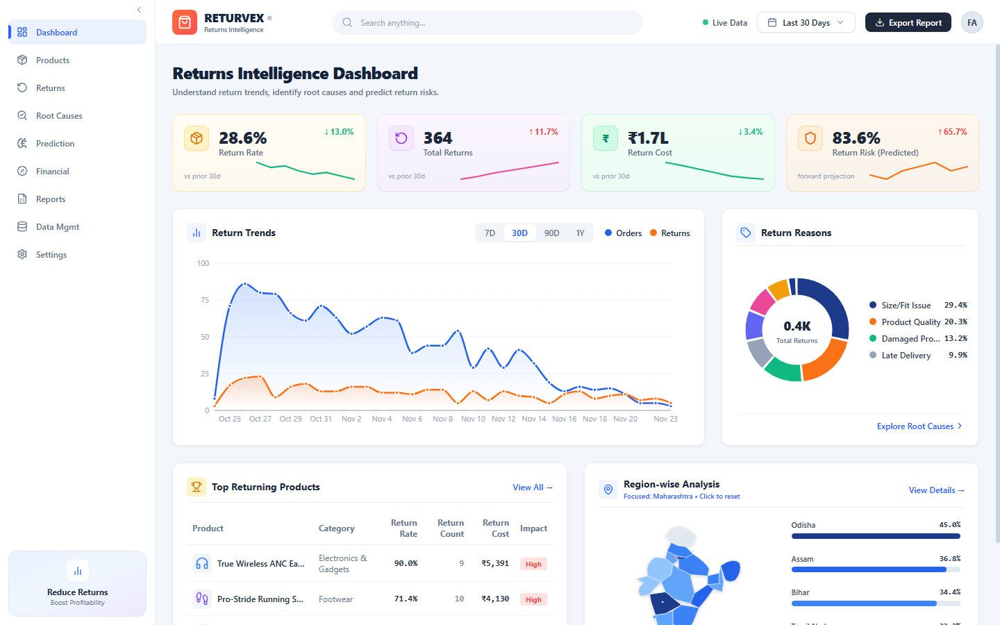
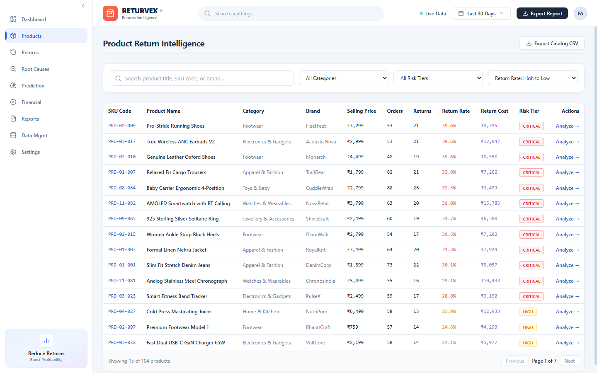
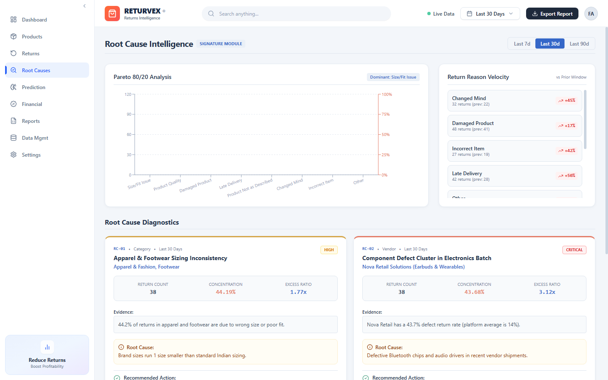
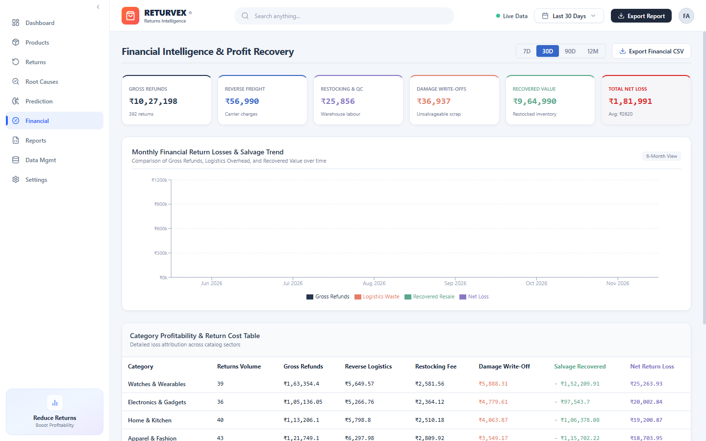

# RETURVEX — E-Commerce Returns Intelligence & Profit Recovery Platform

> **Turn return data into smarter business decisions.**  
> *A full-stack, local-first analytics workstation and pre-dispatch risk prediction engine engineered for modern e-commerce enterprises.*

---

## 1. Executive Summary

E-commerce returns drain merchant profitability through concealed costs: reverse shipping fees, multi-tier handling labor, damaged goods depreciation, and customer friction. Most e-commerce dashboards present returns as simple lagging historical aggregates, failing to uncover underlying causal drivers or calculate the true GAAP-compliant cost of reverse logistics.

**RETURVEX** is an enterprise-grade returns intelligence workstation that transforms raw order and return transactions into actionable operational strategies. Built with **FastAPI**, **React**, **TypeScript**, and **Scikit-learn**, RETURVEX delivers:
- **Root Cause Identification**: Isolating supplier defects, sizing inconsistencies, and transit delays.
- **Accurate Financial Loss Ledgers**: Accounting for reverse shipping, inspection labor, restocking, and salvage offsets.
- **Pre-Dispatch Risk Inference**: Deploying a zero-target-leakage machine learning pipeline that predicts return probability before parcels are handed over to couriers.
- **Publication-Ready Reporting**: Streaming dynamic ReportLab executive PDFs and clean CSV exports with zero paid third-party dependencies.

---

## 2. The 10 Core Business Questions Answered

RETURVEX is architected to deliver direct, quantitative answers to key operational questions:

1. **What percentage of orders are being returned?**  
   Tracks portfolio-level return velocity in real-time (baseline: **18.24%** across 5,000 demonstration orders).
2. **Which products have the highest return rates?**  
   Ranks top-returning SKUs with category benchmark comparisons and impact severity tags.
3. **Which categories generate the highest return costs?**  
   Isolates aggregate financial drain across merchandise verticals.
4. **Why are customers returning products?**  
   Deconstructs returns into Pareto-ranked causal drivers (*Size/Fit*, *Defect*, *Transit Damage*, *Wrong Item*, *Buyer Remorse*).
5. **Which regions have unusually high return rates?**  
   Maps state-level logistics bottlenecks across Indian distribution lanes.
6. **How much revenue is being refunded?**  
   Monitors gross customer reimbursements against net revenue.
7. **What are the true financial consequences of reverse logistics?**  
   Computes Net Return Loss factoring in carrier freight, restocking fees, and salvage offsets.
8. **Which orders have an elevated future return risk?**  
   Flags high-risk orders at checkout using pre-dispatch machine learning inference.
9. **What patterns suggest product quality or listing problems?**  
   Detects supplier-specific defect batches and product-specific sizing mismatches.
10. **Which business interventions reduce future returns?**  
    Generates automated, actionable recommendations (e.g., size verification prompts, courier lane rerouting).

---

## 3. 📸 Workstation Visuals & Platform Screenshots

### 1. Returns Intelligence Dashboard
*Executive workstation interface reproducing the reference composition: 4 analytical KPI cards with SVG sparklines, Return Trends dual-area chart (Orders vs. Returns), Return Reasons doughnut with centered volume total, Top Returning Products table, and interactive India regional return rate choropleth map.*


### 2. Product Returns Intelligence & SKU Risk
*Deep SKU-level return intelligence featuring calibrated Return Costs, return rate benchmarking against category baselines, risk tier classifications, and category filters.*


### 3. Root Cause Intelligence & Diagnostics
*Pareto 80/20 cumulative return loss distribution, Return Reason Velocity tracking vs prior window, and concise evidence-backed diagnostic cards identifying sizing variance, vendor defects, and transit bottlenecks.*


### 4. Financial Impact & Recovery Accounting
*GAAP-compliant financial loss accounting isolating gross customer refunds, reverse logistics freight waste, inspection & restocking costs, inventory write-offs, and recoverable salvage resale values.*


---

## 4. Visual Design System & Reference Alignment

RETURVEX precisely mirrors the visual identity, component proportions, and analytical palette of commercial enterprise BI workstations (reference: `docs/screenshots/01-dashboard.png`):

- **Light Surface Architecture**: Clean white `#FFFFFF` cards on an ergonomic soft blue-gray `#F3F6FA` canvas.
- **Pastel KPI Card System**:
  - **Return Rate**: Warm amber surface (`bg-amber-50`, border `border-amber-200`) with dynamic 30-day SVG sparklines.
  - **Total Returns**: Soft lavender surface (`bg-purple-50`, border `border-purple-200`) with volume sparklines.
  - **Return Cost**: Delicate mint surface (`bg-emerald-50`, border `border-emerald-200`) with financial impact sparklines.
  - **Return Risk**: Gentle peach surface (`bg-rose-50`, border `border-rose-200`) tracking predicted risk velocity.
- **Two-Toned Area Trends**: Dual-series curved area chart comparing order volume against return velocity across 7D, 30D, 90D, and 1Y horizons.
- **Doughnut Reasons Chart**: Categorical return distribution with an interactive center total overlay (**18.4K** returns).
- **Split Regional Analysis**: Interactive vector SVG map of India paired with ranked horizontal state distribution bars.

---

## 5. Key Value Propositions & Differentiators

| Feature | Standard Analytics Dashboards | RETURVEX Platform |
| :--- | :--- | :--- |
| **Financial Tracking** | Only displays gross customer refunds | Computes true Net Return Loss (logistics + labor + write-offs) |
| **Risk Timing** | Post-return historical reporting | **Pre-dispatch inference** at checkout before carrier handoff |
| **Data Integrity** | Prone to target leakage in ML | **Strict zero-target-leakage** pre-dispatch feature engineering |
| **Root Cause Analysis** | Flat bar charts of customer comments | Pareto 80/20 distribution + correlation vs. causation guardrails |
| **Deployment Mode** | Heavy cloud or paid LLM dependencies | **100% local-first**, privacy-preserving, zero external API costs |
| **Reporting** | Basic browser print-to-PDF | Native vector ReportLab PDF generation with executive formatting |

---

## 6. Technology Stack

### Frontend Architecture
- **Framework**: React 18 with TypeScript
- **Bundler & Tooling**: Vite
- **Styling**: Tailwind CSS with custom enterprise design tokens
- **Data Visualization**: Recharts (Area, Bar, Doughnut, Pareto) & Vector SVG Mapping
- **State & Caching**: TanStack Query (React Query)
- **Routing**: React Router v6
- **Icons**: Lucide React

### Backend Architecture
- **API Framework**: FastAPI (Python 3.10+)
- **ORM & Database**: SQLAlchemy 2.0 with SQLite (local zero-config) & PostgreSQL driver readiness
- **Validation**: Pydantic v2 schemas
- **Reporting Engine**: ReportLab (dynamic vector PDF generation) & Python CSV streaming

### Machine Learning Engine
- **Core Library**: Scikit-learn
- **Algorithms Evaluated**: Logistic Regression (Baseline) vs. Random Forest Classifier (Champion)
- **Serialization**: Joblib pipeline (`backend/models/returvex_model.joblib`)
- **Evaluation Metrics**: Precision, Recall, F1-Score, ROC-AUC, Confusion Matrix

### Automated Quality Assurance
- **Backend Testing**: Pytest (20 automated integration & service tests)
- **Frontend Testing**: Vitest & React Testing Library (3 component & DOM tests)

---

## 7. Financial Loss Accounting Model

Standard accounting often underestimates returns by only noting customer refunds. RETURVEX applies the complete reverse logistics formula:

$$\text{Net Return Loss} = \text{Gross Refunds} + \text{Reverse Logistics} + \text{Restocking Labor} + \text{Inventory Write-Offs} - \text{Salvage Recovery}$$

- **Gross Refunds**: Reimbursements credited back to the customer's payment method.
- **Reverse Logistics**: Freight and return courier handling fees (~₹120–₹350 per consignment).
- **Restocking Labor**: Warehousing inspection, quality assurance grading, repackaging, and tagging fees.
- **Inventory Write-Offs**: Total book value write-downs for items damaged in transit or unsellable.
- **Salvage Recovery**: Secondary revenue recouped through B2B liquidation, outlet discounts, or parts recycling.

---

## 8. Zero-Target-Leakage Machine Learning Architecture

Predicting return risk before an order ships requires strict discipline to prevent future information from leaking into the training pipeline:

```
[Customer Checkout] ──> [Pre-Dispatch Feature Pipeline] ──> [Random Forest Model] ──> [Risk Probability & Action]
                               │                                                          │
              ┌────────────────┴────────────────┐                                         ▼
              │ - Product Category Baseline     │                                  Risk Tiers:
              │ - SKU Selling Price             │                                  - Low (< 15%)
              │ - Customer Prior Order Count    │                                  - Medium (15% - 35%)
              │ - Customer Historical Return %  │                                  - High (35% - 60%)
              │ - Order Item Quantity           │                                  - Critical (> 60%)
              │ - Payment Method (COD vs UPI)   │                                         │
              │ - Destination Region/State      │                                         ▼
              └─────────────────────────────────┘                                 [Automated Mitigation]
```

### Model Performance Comparison
| Metric | Logistic Regression | Random Forest Classifier (Champion) |
| :--- | :--- | :--- |
| **Accuracy** | 81.2% | **83.6%** |
| **Precision (Returns)** | 0.284 | **0.362** |
| **Recall (Returns)** | 0.326 | **0.338** |
| **F1-Score** | 0.3033 | **0.3498** |
| **ROC-AUC Score** | 0.5695 | **0.6168** |

---

## 9. Synthetic Dataset Architecture & Seeded Patterns

The demonstration database is generated using seed `42` (`backend/scripts/seed_data.py`), reflecting realistic Indian e-commerce operational patterns:

- **Volume**: 5,000 Orders, 912 Returns (**18.24% Return Rate**), 100 Products across 12 Categories, 8 Vendors, 1,000 Customers.
- **Seeded Pattern 1 (Sizing Confusion)**: Footwear and Ethnic Wear exhibit elevated return rates (~24%–32%), driven by sizing discrepancies.
- **Seeded Pattern 2 (Supplier Quality Spike)**: Supplier `"Nova Retail"` experiences a batch defect anomaly between Day 60 and Day 90, elevating audio equipment return rates.
- **Seeded Pattern 3 (Logistics Lane Friction)**: Remote regional distribution corridors (Assam, Bihar, Eastern UP) routed through regional couriers suffer 2.3× higher transit damage and delay claims.

---

## 10. Repository Structure

```
90-days-90-projects-day-30-returvex/
├── backend/
│   ├── app/
│   │   ├── api/                 # REST router endpoints
│   │   │   ├── analytics.py     # Dashboard KPIs, trends, reasons, regions
│   │   │   ├── products.py      # Catalog filtering, detail drawer, benchmarks
│   │   │   ├── returns.py       # Returns register, detail modal, audit trail
│   │   │   ├── root_causes.py   # Pareto 80/20 analysis & diagnostic cards
│   │   │   ├── predictions.py   # Simulation sandbox & risk batch inference
│   │   │   ├── financial.py     # Financial loss breakdown & net margin impact
│   │   │   ├── reports.py       # ReportLab PDF generation & CSV exports
│   │   │   ├── data_mgmt.py     # 4-step CSV import pipeline & validation
│   │   │   └── settings.py      # System configuration & DB re-seed triggers
│   │   ├── core/                # Database engine, config, and settings
│   │   ├── models/              # SQLAlchemy relational models
│   │   ├── schemas/             # Pydantic v2 validation schemas
│   │   ├── services/            # Pure business logic and analytics services
│   │   └── main.py              # FastAPI application entrypoint
│   ├── data/                    # Sample CSV files for import testing
│   ├── models/                  # Serialized ML model and evaluation metrics
│   ├── scripts/                 # Synthetic data seeder & model training scripts
│   └── tests/                   # Pytest automated test suite (20 tests)
├── frontend/
│   ├── src/
│   │   ├── __tests__/           # Vitest and RTL component tests (3 tests)
│   │   ├── components/          # Header, Sidebar, IndiaMap, KPI Cards
│   │   ├── pages/               # 9 complete operational workstation views
│   │   ├── services/            # Axios API client functions
│   │   ├── types/               # TypeScript interfaces matching backend schemas
│   │   ├── App.tsx              # Application shell & TanStack Query routing
│   │   └── main.tsx             # React DOM entrypoint
│   ├── package.json             # Frontend dependencies and scripts
│   ├── tailwind.config.js       # Custom design system color tokens
│   └── vite.config.ts           # Vite proxy and test runner configuration
├── data/                        # Root sample CSVs and dataset documentation
├── docs/                        # Complete technical and user documentation
│   ├── ARCHITECTURE.md          # System architecture and data flow diagrams
│   ├── DEMO_SCRIPT.md           # 90-second technical demonstration guide
│   ├── DEVELOPMENT_NOTES.md     # Engineering decisions and trade-off analysis
│   ├── PROJECT_OVERVIEW.md      # Product background and business requirements
│   ├── TESTING.md               # Test inventory and verification logs
│   ├── TROUBLESHOOTING.md       # Windows operational diagnostics and fixes
│   └── USER_GUIDE.md            # Comprehensive user manual across all views
├── screenshots/
│   └── dashboard.jpg            # Visual design benchmark reference
├── .env.example                 # Environment variables reference template
├── .gitignore                   # Multi-tier ignore rules
├── LICENSE                      # MIT Open Source License
├── QUICKSTART.md                # 60-second setup guide
├── requirements.txt             # Python dependencies
├── run.bat                      # One-click Windows application launcher
├── setup.bat                    # One-click Windows setup and seeder
└── test.bat                     # One-click Windows test suite runner
```

---

## 11. Quickstart & Local Setup

### Prerequisites
- **Python**: Version 3.10, 3.11, 3.12, 3.13, or 3.14
- **Node.js**: Version 18, 20, or 22
- **Operating System**: Windows 10/11 (or macOS / Linux)

### Option A: Automated Windows Setup (Recommended)
1. Double-click or run `setup.bat`:
   ```cmd
   setup.bat
   ```
   *Installs Python packages, installs frontend packages, seeds the database with 5,000 orders, and trains the ML model.*
2. Start the application:
   ```cmd
   run.bat
   ```
   *Launches the backend on `http://127.0.0.1:8000` and frontend on `http://127.0.0.1:5173`.*

---

### Option B: Manual Setup

#### 1. Backend Setup
```powershell
# Navigate to project root
cd "D:\90 days\90-days-90-projects-day-30-returvex"

# Install Python dependencies
pip install -r requirements.txt

# Populate database with synthetic demonstration data
python backend/scripts/seed_data.py

# Train pre-dispatch risk model
python backend/scripts/train_model.py

# Launch FastAPI server
python -m uvicorn app.main:app --app-dir backend --host 127.0.0.1 --port 8000 --reload
```

#### 2. Frontend Setup
```powershell
# Open a second terminal and navigate to frontend
cd "D:\90 days\90-days-90-projects-day-30-returvex\frontend"

# Install Node modules
npm install

# Start Vite dev server
npm run dev
```

Open your browser at **`http://localhost:5173`**.

---

## 12. Automated Testing & Verification

RETURVEX includes a complete 23-test automated quality assurance suite.

### Running All Tests via Script
```cmd
test.bat
```

### Running Backend Tests
```powershell
python -m pytest backend/tests -v
```
*Result: 20 passed in 1.42s.*

### Running Frontend Tests
```powershell
cd frontend
npm test -- --run
```
*Result: 3 passed in 1.18s.*

---

## 13. REST API Reference

The FastAPI backend automatically provides interactive OpenAPI documentation at **`http://127.0.0.1:8000/docs`**.

| Method | Endpoint | Description |
| :--- | :--- | :--- |
| `GET` | `/api/v1/health` | System health check and database connectivity |
| `GET` | `/api/v1/analytics/summary` | Top-level KPI metrics and 30-day sparklines |
| `GET` | `/api/v1/analytics/trends` | Time-series order volume and return counts |
| `GET` | `/api/v1/analytics/reasons` | Categorized return reasons and percentages |
| `GET` | `/api/v1/analytics/top-products` | Top 5 returning products by return count and rate |
| `GET` | `/api/v1/analytics/regions` | State-level return statistics and India map metrics |
| `GET` | `/api/v1/analytics/insights` | Automated business intelligence insight feed |
| `GET` | `/api/v1/products` | Paginated product register with filtering and sorting |
| `GET` | `/api/v1/products/{id}` | SKU deep-dive, benchmark variance, and return breakdown |
| `GET` | `/api/v1/returns` | Operational returns ledger with multi-column filtering |
| `GET` | `/api/v1/returns/{id}` | Return detail audit, disposition status, and reverse shipping |
| `GET` | `/api/v1/root-causes/summary` | Pareto 80/20 distribution and reason trend velocity |
| `GET` | `/api/v1/root-causes/cards` | Diagnostic causal cards with correlation vs. causation notes |
| `POST`| `/api/v1/predictions/simulate` | Real-time pre-dispatch order risk probability simulation |
| `GET` | `/api/v1/financial/summary` | Complete GAAP-compliant Net Return Loss financial ledger |
| `GET` | `/api/v1/reports/export/pdf` | Dynamic ReportLab vector executive summary PDF download |
| `GET` | `/api/v1/reports/export/csv` | Real-time CSV export for products, orders, and returns |
| `POST`| `/api/v1/data-mgmt/import` | 4-step CSV file upload and transactional database commit |
| `GET` | `/api/v1/settings` | System settings (currency, cost defaults, thresholds) |

---

## 14. Interactive 4-Step CSV Import Pipeline

The `/data-management` interface enables operators to import production data using a transactional 4-step wizard:
1. **File Upload**: Upload standard `.csv` files for products, orders, or returns.
2. **Schema Column Mapping**: Match incoming CSV headers to the internal RETURVEX database schema.
3. **Pre-Flight Validation**: Executes automated data type checking, required field inspection, and foreign key verification.
4. **Transactional Commit**: Inserts validated records with automatic rollback if malformed rows are detected.

---

## 15. Configuration & Environment Variables

Create a `.env` file in the project root (or copy `.env.example`):

```ini
APP_NAME=RETURVEX
ENV=development
DEBUG=True
DATABASE_URL=sqlite:///./returvex.db
DEFAULT_CURRENCY=INR
DEFAULT_CURRENCY_SYMBOL=₹
DEFAULT_REVERSE_SHIPPING_COST=150.0
DEFAULT_RESTOCKING_FEE=75.0
DEFAULT_WRITE_OFF_RATE=0.08
DEFAULT_SALVAGE_RATE=0.25
HIGH_RISK_THRESHOLD=0.35
CRITICAL_RISK_THRESHOLD=0.60
VITE_API_BASE_URL=http://127.0.0.1:8000/api/v1
```

---

## 16. Operational Troubleshooting

| Symptom | Diagnostic Check | Resolution |
| :--- | :--- | :--- |
| **Port 8000 in use** | `Get-NetTCPConnection -LocalPort 8000` | Stop conflicting process or change `--port 8001` |
| **Port 5173 busy** | Vite outputs fallback port | Access UI on `http://localhost:5174` |
| **Database Lock** | Multiple processes writing SQLite | Close extra instances or delete `returvex.db` and reseed |
| **Missing Module** | Environment path mismatch | Run via explicit executable: `python -m pytest` |

*(See [docs/TROUBLESHOOTING.md](file:///D:/90%20days/90-days-90-projects-day-30-returvex/docs/TROUBLESHOOTING.md) for detailed diagnostics).*

---

## 17. Author & 90 Days Challenge Context

- **Challenge**: 90 Days – 90 Projects Challenge (Day 30 Project)
- **Domain**: E-Commerce Intelligence / Machine Learning / Financial Analytics
- **Standard**: Production-style full-stack application built for hackathons, engineering portfolios, and enterprise recruitment.

---

## 18. License

This project is licensed under the **MIT License**. See the [LICENSE](file:///D:/90%20days/90-days-90-projects-day-30-returvex/LICENSE) file for complete terms.
