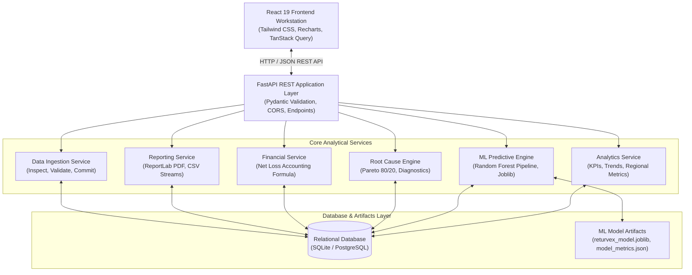
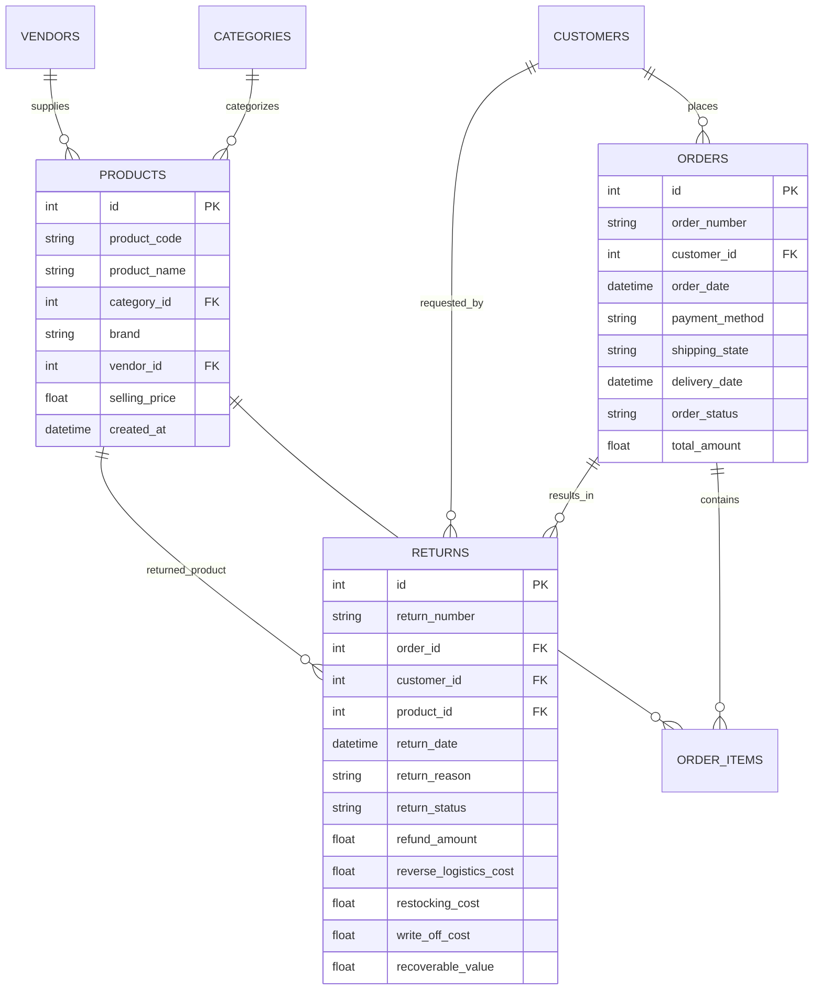

# RETURVEX — System Architecture & Data Flow

## 1. High-Level Architecture Overview

RETURVEX uses a modern decoupled architecture:
- **Presentation Layer**: React 19, TypeScript, Vite, Tailwind CSS, Recharts, Lucide React, TanStack Query.
- **Application & API Layer**: Python FastAPI, Pydantic v2, SQLAlchemy 2.0 ORM.
- **Analytics & ML Inference Engine**: Scikit-learn (Random Forest champion & Logistic Regression baseline), Pandas, NumPy.
- **Reporting & Document Generation**: ReportLab PDF generator, streaming CSV exporter.
- **Storage Layer**: Relational database (SQLite local zero-config default; PostgreSQL ready).

---

## 2. Database Relational Model

---

## 3. Financial Loss Formula Specification

RETURVEX enforces a rigorous accounting formula to distinguish customer cash refunds from net operational company loss:

$$\text{Total Net Return Cost} = \text{Gross Refund} + \text{Reverse Courier Logistics} + \text{Restocking / Inspection} + \text{Damage Write-Off} - \text{Recoverable Salvage Value}$$

Where:
- **Gross Refund**: Direct customer reimbursement outflow.
- **Reverse Courier Logistics**: Fixed or distance-weighted reverse freight fee.
- **Restocking / Inspection**: Warehouse receiving, unpacking, QA triage labor.
- **Damage Write-Off**: Valuation discount on unsalvageable or defective items.
- **Recoverable Salvage Value**: Inventory resale salvage credited back into working capital.

---

## 4. Machine Learning Pipeline Architecture

The supervised binary classification pipeline is designed with zero future target leakage:
1. **Chronological Sorting**: Transactions are sorted strictly by `order_date`.
2. **Pre-Dispatch Features**:
   - `category_name`, `selling_price`, `discount_amount`, `order_quantity`, `shipping_state`, `payment_method`.
   - `customer_order_count` (orders placed strictly prior to current order).
   - `customer_prior_return_rate` (prior returns / prior orders).
   - `estimated_delivery_days` (carrier SLA estimate at order time).
3. **Pipeline Transformers**:
   - `OneHotEncoder(handle_unknown="ignore")` for categorical dimensions.
   - `StandardScaler()` for continuous monetary and historical metrics.
4. **Champion Selection**: Model performance is evaluated on stratified test sets comparing Logistic Regression and Random Forest on F1-score and ROC-AUC.
